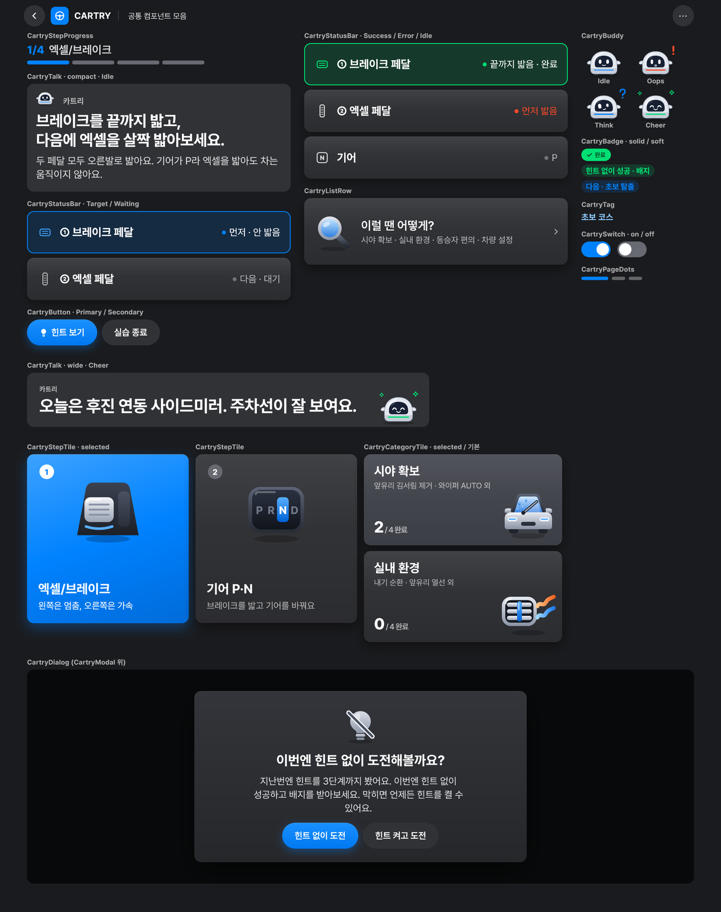
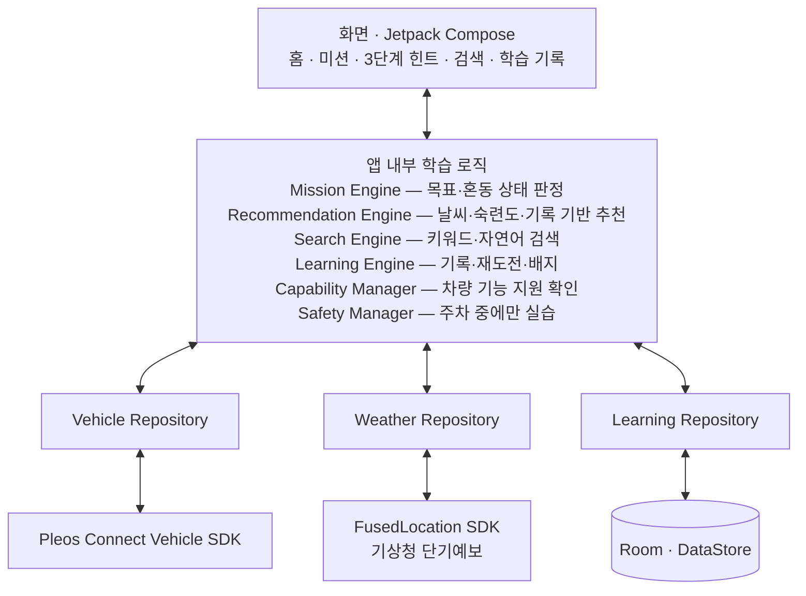

# CARTRY

**내 차의 기능, 직접 해보며 익히다.** — *Learn Your Car by Doing.*

CARTRY 는 운전자에게 필요한 차량 기능을 맞춤형으로 추천하고, 실제 차량 조작과 차량 상태 피드백으로 사용법을 익히게 하는 차량용 학습 앱입니다. 현대자동차그룹 **Pleos Connect** 위에서 동작하며, 모든 실습은 주차 중에만 진행합니다.

앱이 "앞유리가 뿌옇게 됐어요. 필요한 기능을 켜보세요." 같은 미션을 내면, 운전자는 주차된 내 차에서 실제 버튼과 레버를 조작합니다. CARTRY 는 Pleos Connect Vehicle SDK 로 바뀐 차량 상태를 읽어 목표를 달성했는지 판정하고, 비슷한 다른 기능을 눌렀다면 "지금은 뒷유리 열선이 켜졌어요."처럼 실제로 무엇이 바뀌었는지 알려 줍니다.



## 왜 필요한가

- 운전자는 차량 기능을 **필요한 순간에야 처음 찾습니다.** 비 오는 날 출발한 뒤에 와이퍼 레버를 이리저리 돌려 보고, 앞유리 김서림을 없애려다 뒷유리 열선을 켭니다.
- 신차 기능의 상당수는 쓰이지 않습니다. J.D. Power 조사(2015, 신차 오너 4,200명)에서 33개 기술 기능 중 16개를 오너의 20% 이상이 구매 후 90일 동안 한 번도 쓰지 않았습니다.
- 알고 있어도 작동 방식은 모르는 경우가 많습니다. 미국 아이오와대 조사(운전자 2,015명)에서 40% 가 차가 예상과 다르게 작동한 경험이 있다고 답했습니다.
- 설명서와 영상만으로는 **내 차의 어느 버튼인지, 제대로 작동시켰는지** 운전자가 스스로 판단해야 합니다.
- 불편에서 끝나지 않습니다. 비 오는 날 교통사고 치사율은 맑은 날의 약 1.3배입니다(한국교통안전공단, 2023~2025).

## 주요 기능

| 기능 | 하는 일 |
| --- | --- |
| 차량 상태 기반 학습 피드백 | 운전자가 실제 버튼·레버를 조작하면 차량 상태로 성공을 판정합니다. 다른 기능을 조작했으면 실제로 바뀐 상태와 목표 기능의 차이를 알려 주고, 기능 설명 → 아이콘 비교 → 조작 위치 안내의 3단계 힌트로 스스로 찾게 합니다 |
| 날씨 기반 학습 추천 | 현재 위치의 날씨로 출발 전에 알아 두면 좋은 기능을 홈 화면에 추천합니다. 비 오는 날 와이퍼, 추운 날 앞유리 김서림 제거, 안개 낀 날 전조등·안개등 |
| 숙련도별 학습 추천 | 처음 실행할 때 초보·능숙 코스를 고릅니다. 초보 운전자에게는 기본 조작 튜토리얼과 아직 익히지 않은 기본 기능을, 능숙 운전자에게는 드라이브 모드·운전 자세 메모리처럼 모르고 지나치기 쉬운 편의 기능을 추천합니다. 코스는 언제든 바꿀 수 있고 학습 기록은 유지됩니다 |
| AI 기반 학습 검색 | "차 유리에 김이 꼈어"처럼 기능 이름을 몰라도 글이나 음성으로 상황을 말하면 맞는 학습 미션으로 연결합니다 |
| 학습 기록·성취 관리 | 기능별 완료 여부와 힌트 사용 기록을 저장합니다. 힌트를 썼던 기능은 힌트 없이 다시 도전하도록 안내하고, 서로 다른 기능의 완료 개수로 등급 배지를 줍니다(왕초보 → 초보 탈출 → 자동차의 신) |
| 주행 이력 기반 복습 추천 | 주행 중 와이퍼 대신 방향지시등·워셔액을 여러 번 작동시켰다면, 주차 후 "아까 와이퍼를 켜려고 하셨나요?"라며 복습을 제안합니다 (확장 기능) |

## 차량 상태 판정 방식

CARTRY 는 차량의 모든 상태를 보지 않고, 미션마다 성공 판정에 필요한 **목표 상태**와 헷갈리기 쉬운 **혼동 후보 상태**만 골라 감지합니다. 상태 변경 리스너가 있는 기능은 리스너로, 없는 기능은 미션 진행 중에만 주기적으로 조회합니다. 학습을 시작하기 전에 Vehicle SDK 의 Capability API 로 이 차가 해당 기능을 지원하는지 확인합니다.

| 미션 | 목표 상태 | 혼동 후보 | Vehicle SDK |
| --- | --- | --- | --- |
| 앞유리 김서림 제거 | 앞유리 디프로스터 ON | 뒷유리 열선 ON, 풍량 변경 | `getHvacDefrosterState`, `registerHvacDefrosterState`, `registerHvacFanSpeed` |
| 와이퍼 조작 | 앞유리 와이퍼 AUTO | LOW·HIGH 등 다른 모드, 후면 와이퍼 | `getCurrentWiperSwitch`, `getCurrentWiperState` |
| 뒷좌석 창문 조작 잠금 | 창문 조작 잠금 ON | 창문 위치 변경, 도어 잠금 변경 | `getCurrentWindowLockState`, `registerWindowLockState`, `registerWindowPosition` |

## 구현 범위

| 단계 | 내용 | 상태 |
| --- | --- | --- |
| 공통 화면 부품 | 디자인 토큰, 공통 컴포넌트, 아이콘 87개 ([designsystem](designsystem/README.md)) | 완료 |
| 1단계 | 앞유리 김서림 제거 · 와이퍼 조작 · 뒷좌석 창문 조작 잠금 미션 + 날씨 기반 추천 | 진행 중 |
| 1단계 | 능숙 운전자 편의 기능 미션 1개 | 진행 중 |
| 2단계 | 숙련도별 추천, AI 학습 검색, 학습 기록·배지 통합, 학습 콘텐츠 확대 | 계획 |
| 3단계 | 주행 이력 기반 복습 추천 | 계획 |

## 기술 스택과 구조

| 영역 | 사용 기술 |
| --- | --- |
| 앱 | Android Automotive OS 기반 Pleos Connect 네이티브 앱, Kotlin, Jetpack Compose |
| 차량 연동 | Pleos Connect Vehicle SDK 2.3.2 (상태 조회 get, 변경 리스너 register, Capability API) |
| 위치·음성 | Pleos FusedLocation SDK, Pleos SpeechToText / TextToSpeech SDK |
| 외부 데이터 | 기상청 단기예보 조회서비스 |
| 로컬 저장 | Room (학습 기록), DataStore (코스 설정) |
| 외부 백엔드 | Spring Boot, PostgreSQL |
| 테스트 | Pleos Connect Emulator, Virtual Console |



## 저장소 구성

```
frontend/
├─ designsystem/   디자인 토큰 · 공통 컴포넌트 · 아이콘 (Jetpack Compose)
├─ CONTRIBUTING.md 팀 작업 안내 (개발 환경, 브랜치·PR 규칙, 코드 리뷰)
└─ .github/        PR 자동 코드 리뷰 설정
```

## 실행 환경

- Android Studio, JDK 17, Kotlin
- Pleos Connect Emulator 2.1.0 (Android API 34 system image), 앱 minSdk 28 이상
- 에뮬레이터는 외장 그래픽 카드가 필요합니다. 자세한 설정은 [CONTRIBUTING](CONTRIBUTING.md#개발-환경-pleos-개발자-문서-원문-기준-2026-11-10-확인)

## 참고

- [Pleos Connect 개발자 문서](https://document.pleos.ai/docs/pleos-only/getting-started), [Vehicle SDK](https://document.pleos.ai/docs/pleos-only/connect-sdk-pleos/Vehicle/intro)
- J.D. Power (2015). *2015 Driver Interactive Vehicle Experience (DrIVE) Report*
- University of Iowa Public Policy Center (2015). *National Consumer Survey of Driving Safety Technologies*
- 한국교통안전공단 교통사고분석시스템(TAAS). 2023~2025년 기상상태별 교통사고 통계
