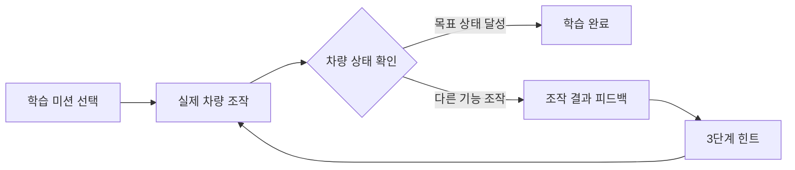
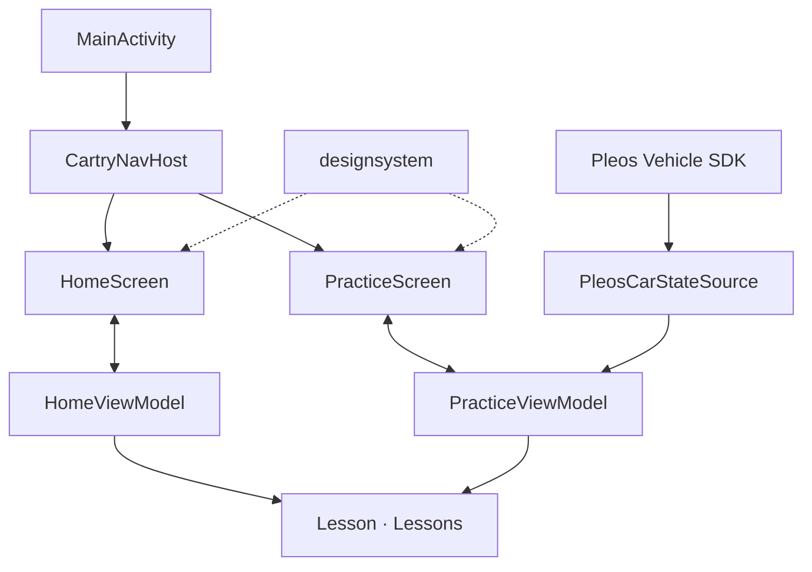

<div align="center">

# CARTRY 🚘

### 내 차의 기능, 직접 해보며 익히다.

**Learn Your Car by Doing.**

차량의 버튼과 레버를 직접 조작하고, 차량 상태 피드백으로 사용법을 익히는  
**Pleos Connect 기반 차량 기능 학습 앱**

</div>

<!-- 📷 이미지 추가 ① | 대표 이미지
CARTRY 로고가 보이는 홈 화면 또는 앱의 핵심 경험을 보여주는 가로형 배너를 추천합니다.
이미지를 docs/images/cartry-cover.png에 넣은 뒤 아래 주석을 해제하세요.


-->

## 🚗 CARTRY 소개

자동차에는 다양한 기능이 있지만, 막상 필요할 때 버튼의 위치나 조작 방법을 몰라 헤매는 경우가 있습니다. 설명서나 영상으로 사용법을 확인하더라도 **내 차에서 올바르게 조작했는지** 판단하기는 쉽지 않습니다.

CARTRY는 이 과정을 **상황에 맞는 미션 → 실제 차량 조작 → 상태 기반 피드백**으로 바꿉니다. 사용자가 기능을 직접 켜거나 조작하면 Pleos Vehicle SDK로 차량 상태를 확인하고, 목표 기능을 정확히 작동시켰는지 알려줍니다. 비슷한 다른 기능을 조작했을 때도 무엇이 작동했는지 설명하고, 힌트를 통해 다시 시도하도록 돕습니다.

> **CARTRY의 핵심은 차량 자체가 학습 도구가 된다는 점입니다.**  
> 단순히 사용법을 읽는 대신, **사용자의 조작과 차량의 반응이 이어지는 상호작용형 학습 경험**을 제공합니다.

CARTRY는 초보 운전자의 기본 조작 학습부터 숙련 운전자의 새로운 편의 기능 탐색까지 폭넓은 학습 경험을 지향합니다. 날씨와 운전 상황에 따른 추천, 자연어 검색, 학습 기록을 통해 차량 기능을 필요한 순간에 익히고 다시 활용하는 서비스를 만들어갑니다.

## ✨ 핵심 학습 경험

### 1. 실제 차량을 직접 조작하는 미션

사용자는 주차된 차량에서 화면이 제시하는 상황에 따라 실제 버튼이나 레버를 조작합니다. 앱은 조작 결과를 차량 데이터로 확인하여 미션을 진행합니다.

### 2. 잘못 조작해도 배울 수 있는 피드백

앞유리 김서림 제거를 켜야 하는데 뒷유리 열선을 켰다면, CARTRY는 단순히 실패를 표시하지 않습니다. **실제로 켜진 기능과 목표 기능의 차이**를 알려주어 비슷한 기능을 구분할 수 있게 합니다.

### 3. 스스로 찾도록 돕는 3단계 힌트

**기능 설명 → 아이콘·유사 기능 비교 → 조작 위치 안내** 순서로 힌트를 제공하며, 사용자는 필요한 만큼 힌트를 확인한 뒤 다시 실습할 수 있습니다.

<!-- 📷 이미지 추가 ② | 핵심 실습 흐름
앞유리 김서림 제거 미션의 4개 화면을 나란히 보여주세요.
① 미션 제시 → ② 잘못된 기능 조작 피드백 → ③ 힌트 → ④ 완료
실제 앱 캡처 또는 짧은 GIF를 추천합니다.


-->

## 📱 차량 연동 실습

CARTRY의 실습 화면은 **미션 안내, 잘못된 조작 피드백, 힌트, 완료** 단계로 이어집니다. 다음 세 가지 미션을 통해 차량의 실제 상태 변화에 반응하는 학습 흐름을 구성했습니다.

| 학습 미션 | 목표 조작 | 헷갈리기 쉬운 기능 |
| --- | --- | --- |
| 앞유리 김서림 제거 | 앞유리 디프로스터 켜기 | 뒷유리 열선 |
| 와이퍼 AUTO | 앞유리 와이퍼를 AUTO로 설정 | 방향지시등 |
| 뒷좌석 창문 잠금 | 뒷좌석 창문 조작 잠금 켜기 | 뒷좌석 창문 열기 |



홈에서는 추천된 미션을 바로 시작하거나 **다른 기능 보기**를 통해 다른 실습을 선택할 수 있습니다. 실습 화면은 차량 상태에 따라 안내 문구와 시각적 피드백을 전환합니다.

<!-- 📷 이미지 추가 ③ | 홈과 실습 화면
홈의 추천 카드 1장과 실습 진행 화면 1장을 함께 보여주세요.


-->

## 🛠 기술 스택

| 영역 | 기술 |
| --- | --- |
| 플랫폼 | Android Automotive OS · Pleos Connect |
| 언어 | Kotlin |
| UI | Jetpack Compose · Material 3 · 자체 디자인 시스템 |
| 화면 이동 | Navigation Compose |
| 상태 관리 | ViewModel · StateFlow · Kotlin Coroutines |
| 차량 연동 | Pleos Vehicle SDK `2.3.2` |
| 빌드 | Gradle Kotlin DSL · Android Gradle Plugin `9.5.1` |

앱은 `:app`과 `:designsystem` 두 개의 Gradle 모듈로 구성되어 있습니다.

### 차량 상태 판정

차량 조작을 단순한 화면 터치로 대체하지 않고, **Vehicle SDK에서 전달받은 상태 변화**를 기반으로 실습 결과를 판정합니다.

- **목표·혼동 상태 감지:** 미션에 필요한 차량 기능만 선택해 상태를 관찰합니다.
- **상태 변화 판정:** 기능이 이미 켜져 있는 경우와 실습 중 `OFF → ON`으로 바뀐 경우를 구분합니다.
- **리스너·주기적 조회 병행:** 이벤트 리스너를 활용하고, 와이퍼 AUTO 여부는 스위치 설정값을 별도로 조회합니다.
- **차량 기능별 상태 처리:** 전·후면 디프로스터, 와이퍼, 방향지시등, 창문 잠금·열림 상태를 각각 처리합니다.
- **실습 생명주기 관리:** 화면 종료 시 등록한 리스너와 주기적 조회 작업을 정리합니다.

주요 구현은 [`PleosCarStateSource.kt`](app/src/main/java/com/cartry/app/vehicle/PleosCarStateSource.kt)와 [`PracticeViewModel.kt`](app/src/main/java/com/cartry/app/practice/PracticeViewModel.kt)에서 확인할 수 있습니다.

## 🧩 프론트엔드 구조



화면은 **Jetpack Compose**, 실습 단계와 차량 상태 관리는 **ViewModel·StateFlow**, 차량 SDK와의 통신은 **`PleosCarStateSource`**가 담당합니다. 미션별 목표 상태, 혼동 후보, 피드백 문구, 힌트와 이미지는 `Lesson` 모델로 구성해 공통 실습 화면에서 활용합니다.

```text
frontend/
├── app/
│   └── src/main/java/com/cartry/app/
│       ├── MainActivity.kt
│       ├── home/          # 홈 화면과 추천 상태
│       ├── lesson/        # 미션 데이터·학습 콘텐츠
│       ├── navigation/    # 화면 이동
│       ├── practice/      # 실습 UI·상태 판정·힌트
│       └── vehicle/       # Pleos Vehicle SDK 연동
├── designsystem/         # 테마·공통 컴포넌트·아이콘
├── gradle/               # Gradle Wrapper·버전 설정
├── CONTRIBUTING.md       # 개발 및 협업 가이드
└── settings.gradle.kts
```

## 🎨 디자인 시스템

CARTRY의 다크 테마 UI는 별도의 [`designsystem`](designsystem/README.md) 모듈에서 관리합니다. 색상, 타이포그래피, 모서리, 간격을 디자인 토큰으로 통일하고, 버튼·카드·상태 표시·단계 진행·마스코트 등을 재사용 가능한 Compose 컴포넌트로 구성했습니다.


화면 디자인과 실습 단계는 Android Studio의 Compose Preview에서도 확인할 수 있습니다.

## 🚀 시작하기

### 개발 환경

- Android Studio 및 Android SDK **37**
- 프로젝트 Gradle Daemon toolchain: **JDK 25**
- Pleos Connect Emulator · Virtual Console (차량 연동 실습)
- Pleos Maven 저장소에 접근 가능한 개발 환경

`minSdk`는 28이며, 앱은 Pleos Connect의 가로형 화면에 맞춰 구성되어 있습니다.

### 프로젝트 실행

```bash
git clone https://github.com/hyundai-cartry/frontend.git
cd frontend

# 디버그 APK 빌드
./gradlew :app:assembleDebug
```

Android Studio에서 프로젝트를 열어 Gradle Sync를 마친 뒤 `app` 실행 구성을 선택해 실행할 수도 있습니다.

빌드된 APK는 다음 경로에서 확인할 수 있습니다.

```text
app/build/outputs/apk/debug/app-debug.apk
```

### 에뮬레이터에 설치

```bash
adb devices
adb install -r app/build/outputs/apk/debug/app-debug.apk
adb shell am start -n com.cartry.app/.MainActivity
```

차량 상태를 사용하는 실습은 **Pleos Connect Emulator와 Virtual Console**을 활용해 확인합니다. 에뮬레이터 준비 및 팀 개발 환경은 [CONTRIBUTING.md](CONTRIBUTING.md)를 참고하세요.

## 🎬 시연 가이드

앞유리 김서림 제거 미션을 예로 들면 다음 흐름을 확인할 수 있습니다.

1. 홈에서 **앞유리 김서림 제거** 미션을 선택합니다.
2. Virtual Console에서 **뒷유리 열선**을 켜 오조작 피드백을 확인합니다.
3. **기능 설명 → 아이콘 비교 → 조작 위치 안내** 힌트를 확인합니다.
4. **앞유리 디프로스터**를 켜 차량 조작 알림과 완료 화면을 확인합니다.
5. **다시 해 보기**를 선택해 동일한 미션을 반복할 수 있습니다.

<!-- 🎞 시연 영상 추가
여기에 시연 영상의 GitHub 링크 또는 유튜브 영상 썸네일을 넣어주세요.

[](시연-영상-URL)
-->

## 🤝 함께 개발하기

브랜치 운영, Pull Request, 코드 리뷰 및 개발 환경에 관한 내용은 [CONTRIBUTING.md](CONTRIBUTING.md)에 정리되어 있습니다.

---

<div align="center">

**CARTRY — 차량을 이해하는 가장 확실한 방법, 직접 해보는 것.**

[Frontend Repository](https://github.com/hyundai-cartry/frontend) · [CARTRY GitHub Organization](https://github.com/hyundai-cartry)

</div>
