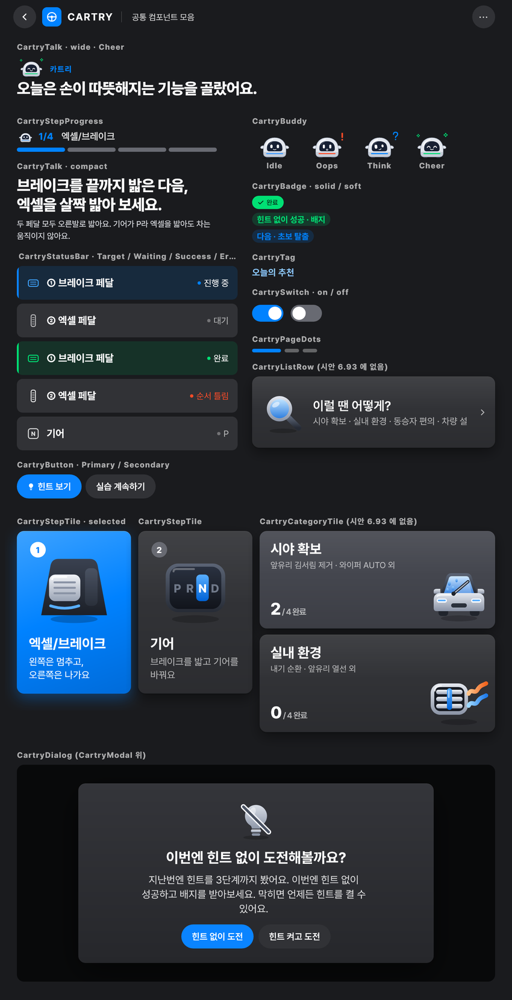

# CARTRY 디자인 시스템 (다크)

UI 시안의 색·글자·모서리·간격을 **디자인 토큰**으로, 화면마다 반복되는 부품을 **공통 컴포넌트**로 옮긴 코드다. 화면을 만들 때 색이나 크기를 직접 쓰지 않고 여기 있는 것을 가져다 쓴다.

**기준은 시안 6.93 가로 1700 판(Figma 섹션 360:2, 앱 창 1700×1184)** 이다(2026-11-13). Pleos 화면 2560×1440 중 왼쪽 860 은 드라이빙 뷰라 앱이 쓰는 창은 1700×1184 다.
1700 판은 왼쪽 글 칸을 화면 종류마다 다른 비율로 줄여 그렸다(실습 화면 80%, 힌트 화면 92%, 단계 상승 화면 90%). 그래서 같은 부품이 화면마다 크기가 다르다. 이 코드는 **부품마다 크기 하나**로 정했고, 그 값은 실습 화면에서 화면에 보이는 크기를 반올림한 것이다. 힌트 화면과 단계 상승 화면은 Figma 와 몇 px 다를 수 있다.



아이콘 87개: [docs/icons.png](docs/icons.png)

## 용어

| 용어 | 뜻 |
| --- | --- |
| Compose (Jetpack Compose) | 안드로이드 화면을 Kotlin 함수로 그리는 방식. 이 폴더의 코드는 전부 Compose 다 |
| 디자인 토큰 | 색·글자 크기 같은 디자인 값에 이름을 붙인 것. `CartryTheme.colors.goal` 처럼 쓴다 |
| 컴포저블 | 화면 한 조각을 그리는 Compose 함수. `CartryButton(...)` 같은 것 |
| ImageVector | Compose 가 쓰는 벡터 그림 형식. 시안의 SVG 아이콘을 이 형식으로 바꿔 두었다 |
| dp / sp | 화면 밀도와 상관없이 같은 크기로 보이게 하는 단위(sp 는 글자용). Pleos 17인치는 160dpi 라 1dp = 1px 이고, 시안의 px 값을 그대로 쓴다 |
| @Preview | Android Studio 미리보기 창에 컴포저블을 그려 주는 표시. 에뮬레이터 없이 화면을 확인할 수 있다 |

## 폴더

```
designsystem/
├─ src/main/kotlin/com/cartry/designsystem/
│  ├─ theme/       토큰: CartryColors · CartryTypography · CartryShapes · CartrySpacing · CartryElevation · CartryTheme
│  ├─ component/   공통 컴포넌트 (아래 표)
│  ├─ icon/        CartryIcons.kt(아이콘 87개) · BuddyVector.kt(카트리 마스코트) — 자동 생성, 직접 고치지 않는다
│  └─ preview/     CartryComponentGallery · CartryIconGallery (모음 화면)
├─ icons-svg/      아이콘 원본 SVG 88개(마스코트 포함). 아이콘을 고칠 때는 이 파일을 고친다
└─ tools/svg_to_compose.py   SVG → Kotlin 변환기
```

## 앱에서 쓰는 법

`designsystem` 은 별도 모듈이고 app 이 `implementation(project(":designsystem"))` 로 쓴다.

- Compose UI **1.9 이상**, 의존성은 `androidx.compose.foundation`, `androidx.compose.ui`. Material 은 쓰지 않는다.
- 글꼴 두 가지를 `app/src/main/res/font/` 에 소문자 이름으로 넣고 테마에 넘긴다. **지금(11-13) app 은 글꼴을 넘기지 않아 안드로이드 기본 글꼴로 그려진다.**
  - 본문: [Pretendard](https://github.com/orioncactus/pretendard) Regular·Medium·SemiBold·Bold·ExtraBold
  - 숫자와 앱 이름: [Barlow Semi Condensed](https://fonts.google.com/specimen/Barlow+Semi+Condensed) Bold·ExtraBold (「CARTRY」, 「1/4」. 넘기지 않으면 Pretendard 로 그린다)

```kotlin
val pretendard = FontFamily(
    Font(R.font.pretendard_regular, FontWeight.Normal),
    Font(R.font.pretendard_medium, FontWeight.Medium),
    Font(R.font.pretendard_semibold, FontWeight.SemiBold),
    Font(R.font.pretendard_bold, FontWeight.Bold),
    Font(R.font.pretendard_extrabold, FontWeight.ExtraBold),
)
val barlow = FontFamily(
    Font(R.font.barlow_semi_condensed_bold, FontWeight.Bold),
    Font(R.font.barlow_semi_condensed_extrabold, FontWeight.ExtraBold),
)
setContent { CartryTheme(fontFamily = pretendard, numberFontFamily = barlow) { /* 화면 */ } }
```

모음 화면은 app 의 `MainActivity.kt` 에 있는 `GalleryPreview`(@Preview 1700×3320)를 Android Studio 미리보기 창에서 본다.

## 토큰

값은 1700 판 시안 HTML 을 브라우저로 렌더링해 **화면에 보이는 크기**(CSS zoom 반영)를 잰 것이다(57화면 전수). 괄호는 시안 CSS 변수 이름.

**색 (`CartryTheme.colors`)** — 뜻이 고정이다. 파랑 = 힌트·목표·지금 할 일, 초록 = 달성, 빨강 = 오작동.

| 이름 | 값 | 쓰는 곳 |
| --- | --- | --- |
| background | #1A1B1E | 앱 바탕 |
| surface (--b100) | #313236 | 카드·말풍선·보조 버튼·원형 버튼 |
| surfaceSelected (--b200) | #44464E | 고른 카드 |
| surfaceTrack (--b300) | #686A72 | 진행 막대 빈 칸, 번호 동그라미 |
| textPrimary / Secondary / Tertiary / Disabled | 흰색 100 / 84 / 64 / 32% | 제목 / 설명 / 보조 / 비활성 |
| goal (--pos) | #0082FF | 목표·힌트 (연한 바탕 goalSoft 16%) |
| success (--act) | #00E074 | 달성 (연한 바탕 successSoft 16%, 위 글자 onSuccess #06301A) |
| danger (--neg) | #FF4C28 | 오작동 |
| action | #0A84FF | 주 버튼 바탕, 목표 상태 막대(연한 바탕 14% + 왼쪽 줄). primaryFill 도 이 한 색 |
| lead | 흰색에 가까운 #F7FAFF 80% | 화면 제목 아래 설명 |
| cardSheen | 위 흰 7.5% → 아래 검정 12% | 카드 위에 한 겹 덮는 광택 |

**글자 (`CartryTheme.type`)** — 크기/굵기/줄 높이

| 이름 | 값 | 쓰는 곳 |
| --- | --- | --- |
| display | 120/800 | 큰 숫자 |
| talkTitle · talkTitleCompact | 52/800/64 | 화면 제목(카트리가 하는 말). 어느 화면이든 52 |
| dialogTitle | 48/700/60 | 모달 제목 |
| tileTitle · cardTitle | 46/700/56 | 튜토리얼 타일 · 홈 카드와 코스 카드 제목 |
| sectionTitle | 36/700/46 | 소제목 |
| body | 34/400/48 | 본문(모달 설명) |
| barTitle · barStatus | 34/700 · 29/400 | 상태 막대 이름 · 상태 |
| progressTitle · progressCounter | 32/600 · 32/800 | 진행 표시 단계 이름 · 「1/4」(숫자 글꼴) |
| appName | 34/700, 자간 0.08em | 「CARTRY」(숫자 글꼴) |
| tileBody | 32/400/44 | 타일 설명 |
| button | 30/600 | 버튼 |
| bodySmall · label | 28/400 · 28/700 | 헤더 화면 이름 · 배지 |
| lead | 27/500/40 | 화면 제목 아래 설명 |
| caption | 26/800/40, 자간 0.08em | 말하는 이 이름 「카트리」 |
| rowTitle · rowBody · tag · pill | 42/600 · 30/400 · 30/700 · 22/600 | 시안 6.93 에 없어진 부품용(예전 값 그대로) |

**모서리** 카드·타일·모달 24, 상태 막대 19, 버튼·배지는 알약, 원형 버튼은 원, 헤더 앱 아이콘 16.
**간격** 시안에 실제로 쓰인 6 · 8 · 10 · 12 · 14 · 16 · 20 · 24 · 28 · 32 · 36 · 40 · 44 · 48 · 56, 화면 좌우 여백 56(앱 창 기준), 헤더 높이 112, 누르는 영역 최소 76.
**그림자** raised(카드) · selectedTile · modal. 시안 CSS box-shadow 를 겹 단위로 옮겼다. 시안 6.93 부터 버튼과 상태 막대에는 그림자가 없다.

## 공통 컴포넌트

| 컴포저블 | 시안 이름 | 하는 일 |
| --- | --- | --- |
| `CartryButton` | btn | 알약 버튼. Primary(파랑 한 색) · Secondary(카드색), 높이 80, 좌우 35, 글자 30, 아이콘 24 |
| `CartryCard` | 카드 바탕 | 카드색 + 광택 + 그림자 + 모서리 24. selected 면 한 단계 밝게 |
| `CartryStatusBar` | sbar | 차 부위 하나의 상태 한 줄. 높이 112. Idle · Waiting · Target(파랑) · Success(초록) · Error(빨강). 목표와 달성은 왼쪽 6 짜리 색 줄 |
| `CartryStepProgress` | prog | [카트리] 「1/4」 「단계 이름」 + 160×14 칸 막대 |
| `CartryPageDots` | dots | 온보딩 쪽 넘김 점 |
| `CartryTalk` | talk | 화면 제목과 설명(말풍선 카드 없음). 넓은 것은 카트리 + 「카트리」 이름 + 제목, 좁은 것(compact)은 제목 52 + 설명 27 |
| `CartryBuddy` | buddy | 카트리 마스코트. Idle · Oops(!) · Think(?) · Cheer(✦), 비 오는 날 물방울 |
| `CartryStepTile` | ttile | 튜토리얼 단계 타일. selected 면 파란 그라데이션 |
| `CartryCategoryTile` | cat | 검색 카테고리 타일(완료 수 + 3D 아이콘). **시안 6.93 에 없음** |
| `CartryListRow` | row | 3D 아이콘 + 제목 + 설명 + 꺾쇠. **시안 6.93 에 없음** |
| `CartryModal` · `CartryDialog` | modal | 검정 55% 막 + 가운데 패널 · 아이콘→제목→설명→버튼 확인 창 |
| `CartryAppHeader` | apphead | 뒤로 · 앱 아이콘 · CARTRY · 화면 이름 · 더보기 |
| `CartrySwitch` | sw | 켜고 끄는 스위치. 보이는 막대 104×56, 누르는 영역 104×76 |
| `CartryBadge` · `CartryTag` | pill · xp · tag | 알약 배지(solid · soft, solid 는 시안 6.93 에 없음) · 파란 글자 꼬리표 |
| `CartryText` | (h1 · lead) | 여러 줄 한국어 문장. 띄어쓰기 자리에서만 줄을 바꾸고, 말풍선 제목은 줄 길이를 고르게 맞춘다 |
| `CartryIcons.*` | i3-* · p-* | 3D 아이콘 44개(`I3…`), 선 아이콘 42개(`Line…`, tint 로 색을 입힌다), 앱 아이콘 1개 |

## 시안과 비교한 결과 (2026-11-13, 1700 판)

1700 판 시안(실습 화면 b1 등)에서 컴포넌트 14개를 보이는 크기 그대로 잘라 내고, 같은 문구로 Compose 렌더링한 것과 화소를 비교했다(PC 용 Compose 로 1dp = 1px 렌더링). 값은 컴포넌트 영역의 평균 화소 차이(0~255)다.

| 컴포넌트 | 차이 | 남은 차이의 이유 |
| --- | --- | --- |
| 버튼, 쪽 넘김 점 | 0.2, 0.3 | |
| 튜토리얼 타일 2종 | 0.8, 0.9 | |
| 상태 막대 4종 | 1.4~2.8 | 글자 가장자리 |
| 넓은 talk | 2.5 | 글자 가장자리 |
| 진행 표시 | 3.2 | 「1/4」 숫자 글꼴(PC 에 Barlow 가 없어 Pretendard 로 그림) |
| 스위치 | 3.6 | 시안 쪽 뒤 배경색 |
| 모달 | 5.4 | 버튼 좌우 여백(시안 44, 코드는 부품마다 하나 규칙으로 35) |
| 헤더 | 6.8 | 「CARTRY」 숫자 글꼴(위와 같음) |
| 좁은 talk | 28.0 | 시안 제목 51.2·설명 27.2 를 52·27 로 반올림. 시안 크기로 그리면 10.4 이고, 그 남은 차이는 글자 가장자리다(줄 위치와 줄 바꿈 자리는 같다) |

- 아이콘 87개는 바뀌지 않았다(원본 SVG 와 평균 화소 차이 0.1 / 255).

## 확인이 필요한 점

1. **1700 판 시안에 24px 보다 작은 글자가 18개(7화면) 있다.** 글 칸을 줄이면서 생겼다(w3·t3 꼬리표 19.7·20.6, tut 「카트리」 20.8, home2 숫자 22, g3·l3·w3 설명 22.1 등). 이 코드의 토큰은 24 아래로 내리지 않았다(pill 만 예전 값 22). 시안도 고쳐야 한다.
2. **목록 행, 카테고리 타일, 「완료」 알약(solid 배지)은 시안 6.93 에 없다.** 지금 앱도 쓰지 않는다. 남길지 지울지 정해야 한다.
3. **글꼴**: 앱이 아직 글꼴을 넘기지 않는다. Pretendard 와 Barlow Semi Condensed 를 res/font 에 넣어야 시안과 같은 모양이 된다.
4. **스위치 꺼짐 색**은 시안에 없어서 진행 막대 빈 칸 색(#686A72)으로 정했다.
5. **안드로이드 빌드는 이 PC 에서 확인하지 못했다.** PC 용 Compose(같은 API)로 컴파일하고 그려서 확인했다. 공개 함수는 인자를 추가만 했다(CartryStepProgress 의 mood, CartryTheme 의 numberFontFamily, 글자 barStatus, 색 action·lead).
6. 아이콘 안 글자(PRND, ECO/NORMAL/SPORT, 초보운전, N·R·60)는 Pretendard 글꼴 모양을 선으로 바꿔 넣었다. 기기 글꼴과 상관없이 같은 모양으로 나온다.

## 아이콘 다시 만들기

```bash
python designsystem/tools/svg_to_compose.py generate designsystem/icons-svg designsystem/src/main/kotlin/com/cartry/designsystem/icon
```

필요한 것: Python 3.10+, `pip install playwright fonttools` 후 `playwright install chromium`, Pretendard 글꼴 설치. 시안 HTML 에서 SVG 를 다시 떼어 낼 때는 `export <시안 html> designsystem/icons-svg` 를 먼저 실행한다.
